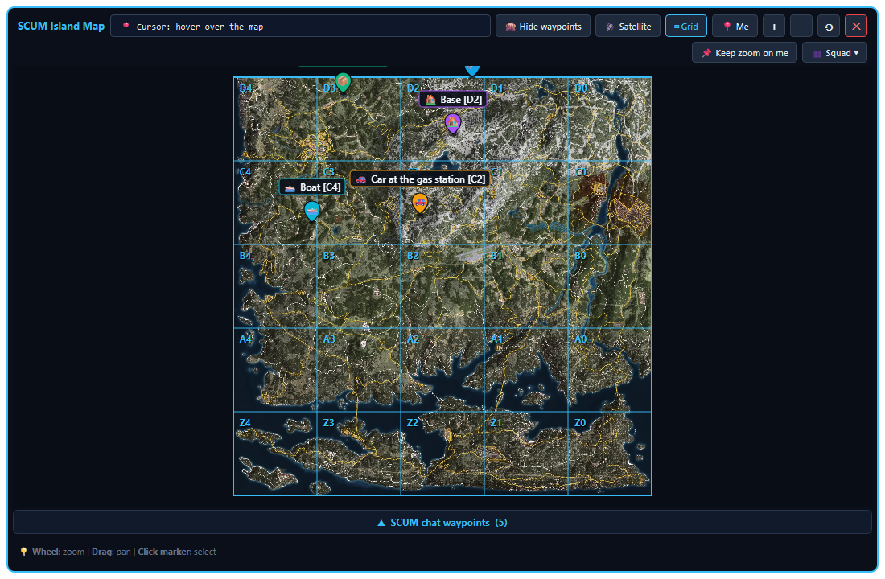
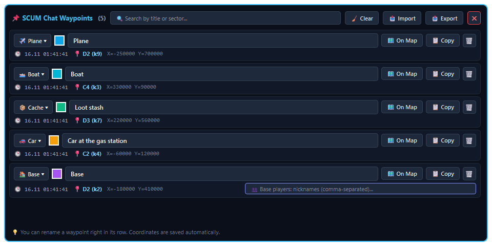
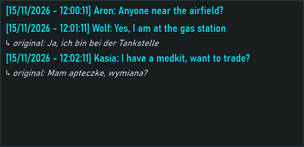
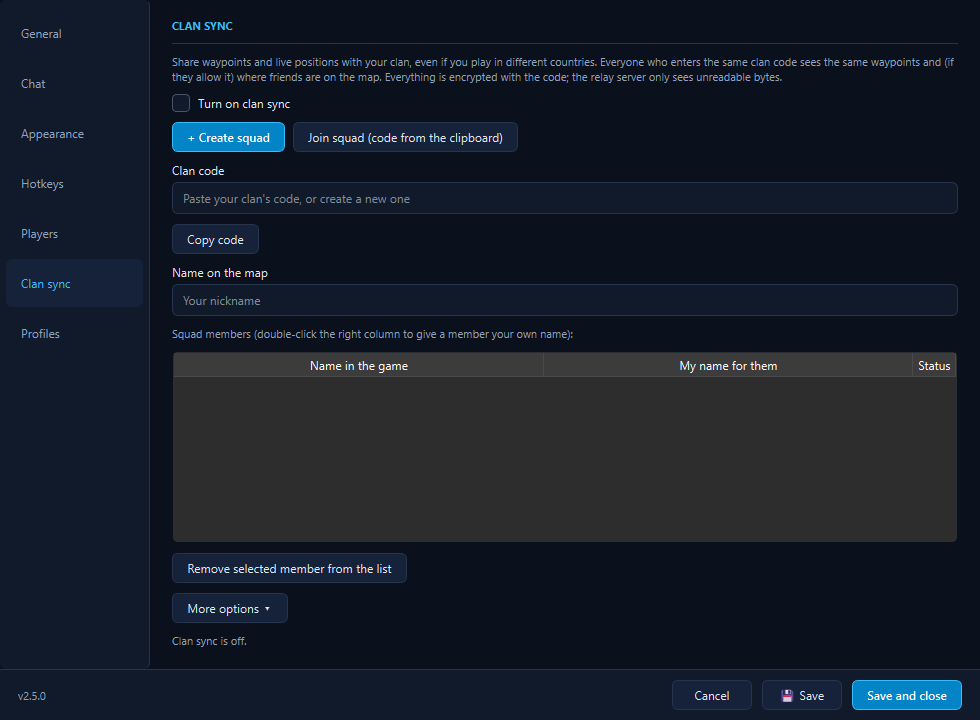
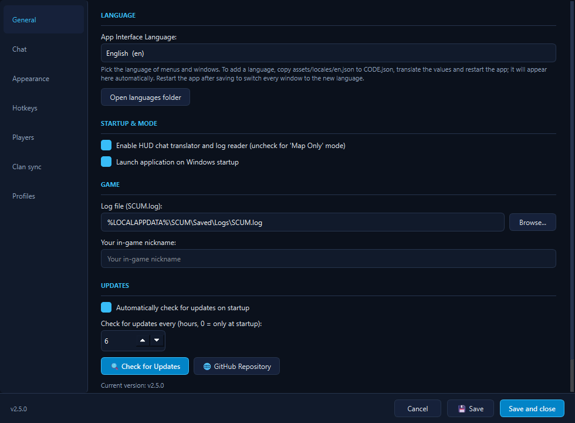

<div align="center">

# SCUM Tactical Map & Chat Translator

[](https://github.com/tankow79/scum-ui-translator-map/releases/latest)
[](https://github.com/tankow79/scum-ui-translator-map/releases)
[](https://microsoft.com)
[](https://github.com/tankow79/scum-ui-translator-map/actions/workflows/ci.yml)
[](LICENSE)

A free Windows overlay for SCUM (Steam). It translates in-game chat on the fly, turns coordinates from chat into pins on an island map, and can share those pins and your position with friends.

**English** · [Українська](docs/readme/README.uk.md)

</div>



## Install

1. Download `SCUM_Chat_Translator.exe` from the [latest release](https://github.com/tankow79/scum-ui-translator-map/releases/latest). The `.zip` holds the same exe plus a short instruction. If you take the zip, extract it first.
2. Put the exe in a folder you can write to, for example `C:\Games\SCUM_Translator\`. Not `Program Files`, and not inside the archive.
3. Double-click it. A blue `SC` icon appears in the system tray, next to the clock. That is the whole app.
4. Start SCUM. Chat translation and the map (`Ctrl + M`) work as soon as the game window is in front.

The first time you run it, Windows may show "Windows protected your PC". Click **More info**, then **Run anyway**. It happens once per file. More on that below.

On first start the interface language follows Windows: Ukrainian Windows gives you Ukrainian, anything else gives English. You can change it any time in **Settings → General → Language**.

The app creates `config.json`, `points.json`, `profiles.json` and `players.json` next to the exe. There is nothing else to copy or configure. Run SCUM in borderless or windowed mode, because exclusive fullscreen cannot show overlays.

## Is it a virus?

No. SmartScreen warns about every program that has no paid code-signing certificate and not many downloads yet. This project is free and unsigned, so Windows complains. It does not mean anything was detected.

Why you can trust it: all the code is in this repository, and you can build the exe yourself. The app does not inject anything, touch game memory or hook the game. It reads SCUM's normal text log and draws its own transparent window. It talks to the network only for Google Translate (the chat text you translate), the GitHub Releases API (update check) and, if you turn it on, the relay servers used by clan sync. GitHub shows a SHA-256 for every release file, so you can compare it with `Get-FileHash .\SCUM_Chat_Translator.exe`.

If there is no "More info" link, or the file does not open at all: right-click the exe, choose **Properties**, tick **Unblock** at the bottom of the General tab, press OK and try again. If your antivirus eats the file, add the folder to its exclusions and download again. Do not turn Defender off and do not install any certificates; neither is needed. Take the app only from this repository's [Releases](https://github.com/tankow79/scum-ui-translator-map/releases) page.

## Disclaimer

This software is for education, research and making chat more accessible. The author takes no responsibility for anything that comes from using it, including bans by Easy Anti-Cheat or BattlEye, account or server penalties, lost data or crashes. You use it at your own risk and you are responsible for following the game's rules and your server's rules.

For the record: no DLL injection, no process memory editing, no API hooking. The app only reads the log the game writes (`%LOCALAPPDATA%\SCUM\Saved\Logs\SCUM.log`) and shows an external window.

## The map



Press `Ctrl + M` in game to open the map over the screen. It hides itself when you Alt-Tab away. You can also open it from the tray menu with SCUM closed.

When anyone posts coordinates in chat, like `car {X=174468 Y=345933 Z=34103}`, the app picks them up and drops a pin. The word next to the coordinates becomes the name, and the category follows from it: base, car, plane, motorcycle, boat, cache or a plain pin. The grid is the official one: sectors D0 to Z4 and keypads k1 to k9, with the sector shown as you move the cursor. There are two styles, satellite and tactical.

The waypoint list is a drawer under the map. Click the bar at the bottom and it slides up. Rename a waypoint right in its row, change its colour or category, search by name or sector, press **On Map** to jump to it, or **Copy** to put the game coordinates on your clipboard. Everything is saved in `points.json`, and you can import and export waypoints as JSON.

For bases you can type the nicknames of the people who live there. The app matches them to SteamIDs from the game log and follows renames, so a base keeps its owners even when they change their names. Hover a base to see them.

The **Me** button zooms to your own position, **Squad** zooms to a friend, and **Hide waypoints** is the PvP mode: it clears the pins and the list so only players are shown.

## Chat translator



Chat appears over the game with the original text under each line. It copies the look of the real chat (Bahnschrift font, black outline, the same timestamp) and fades after 10 seconds by default. Squadmates you list in **Settings → Chat → Players** are lime green, other players are blue, server messages are yellow. The game log does not say which channel a message came from, so local and global chat look the same.

Press `T` and the game chat opens together with a quick input box. Type in your language, and the translation is copied to the clipboard when you press `Enter`. Paste it into the game with `Ctrl + V`. Typing stays smooth because translation runs in the background. `Escape` closes everything and hands the mouse back to the game.

Translation covers more than 100 languages through Google Translate, independent of the interface language. Messages already in your language are skipped. Players on your blacklist show up instantly in the original text, and blocked words can be masked, hidden or left untranslated. If you only want the map, turn on "Map only" and the app stops reading the log completely.

Also in the tray menu: a chat history window with search, filters and export to TXT, CSV or JSON, and profiles, which are named presets for translation, filters and overlay look.

## Clan sync



Friends who play from different countries can share waypoints and see each other on the map. One person presses **Create squad** in **Settings → Clan sync** and sends the code to the others, who press **Join squad**. After that everyone sees the same waypoints, with adds, renames, colour changes and deletes arriving live. Someone who joins late gets everything, and changes made offline go out when the connection comes back. If two people edit the same point, the newest edit wins.

To show your position, press `Ctrl + C` in game. The game copies your coordinates to the clipboard, the app reads them, and friends see your marker with your name and direction. It fades when the data gets old. There is an optional "press Ctrl+C for me" mode, off by default; leave it off if you worry about anti-cheat. The members table lets you give each friend your own name. You can call someone Andriy while he calls you Oleg.

There is no server to host. The app uses public MQTT relay servers as an encrypted mailbox, talks to two of them at once and drops duplicates, so one dead relay does not cut the squad off. The relays only see unreadable bytes. You can set your own relay in the advanced options.

Keep in mind that the clan code is a shared secret. Anyone who has it can read your squad's waypoints and add their own, so give it only to people you trust. Joining a squad also publishes the waypoints you already have, and **Clear all** clears them for everyone.

## Settings



Right-click the tray icon and open **Settings**. **Save** keeps the window open, **Save and close** closes it. Every feature has its own switch, so you can turn off whatever you do not use. The Players page keeps every nickname the game log has shown, linked to the permanent SteamID, with a history of old names. You can turn collecting off, and each delete asks first.

## Hotkeys

| Key | What it does |
|:---:|:---|
| `Ctrl + M` | Show or hide the map and waypoint list |
| `T` | Open game chat and the quick translation box |
| `Enter` | Copy the translation, close the box, then paste with `Ctrl + V` |
| `Escape` | Close the box, map or settings and give the mouse back to the game |
| `F8` | Show or hide the chat overlay |
| `F9` | Unlock the overlay to drag and resize it, lock it again |
| `Ctrl + C` | Share your position with the squad (needs clan sync) |

You can change the main ones in Settings.

## Updates

When a new version is out, an amber `▲` shows on the tray icon. Click it, press **Update now**, and the app downloads the new build, checks its size and SHA-256, runs it once as a self-test, swaps it in and restarts. If anything fails, the old build stays. You can also check by hand in **Settings → General**. Your config, waypoints, profiles and players are never overwritten.

Updating by hand works too: replace the exe with the new one. Downloads go to `%LOCALAPPDATA%\SCUM_Chat_Translator\updates`, the log is in `%LOCALAPPDATA%\SCUM_Chat_Translator\logs\app.log`, and chat history is in `chat_history.jsonl` in the same folder (switch it off in Settings → Chat). The app can also start with Windows; that uses the current user's `Run` registry key and needs no admin rights.

## Troubleshooting

| Problem | What to do |
|---|---|
| Nothing happens on start | Look for the blue `SC` icon in the tray (click the `^` arrow). If another copy is running, it is already there. |
| No translation in game | In **Settings → General** the log path must point to `SCUM.log` and "Map only" must be off. |
| No overlay | Press `F8`, and run SCUM in borderless or windowed mode. |
| Update does not install | The exe must sit in a folder you can write to. Details are in `app.log`. |
| Anything else | [Open an issue](https://github.com/tankow79/scum-ui-translator-map/issues/new/choose) and attach the log with private data removed. |

## Build from source

You need Windows 10 or 11 (64-bit), Python 3.12–3.13 and Git.

```powershell
git clone https://github.com/tankow79/scum-ui-translator-map.git
cd scum-ui-translator-map
python -m venv .venv
.\.venv\Scripts\Activate.ps1
pip install -r requirements-dev.txt
python main.py
```

Checks and the exe build:

```powershell
python -m ruff check .
python -m pytest
python -m PyInstaller --noconfirm SCUM_Chat_Translator.spec
```

The result is `dist\SCUM_Chat_Translator.exe`. See [CONTRIBUTING.md](CONTRIBUTING.md), [docs/ARCHITECTURE.md](docs/ARCHITECTURE.md) and [docs/ADDING_A_LANGUAGE.md](docs/ADDING_A_LANGUAGE.md). Adding a language is one JSON file in `assets/locales/`; the app finds it by itself.

## config.json

| Parameter | Default | Description |
|---|:---:|---|
| `log_file_path` | `%LOCALAPPDATA%\SCUM\...` | Path to the SCUM log. Environment variables are expanded. |
| `target_language` | `"uk"` | Language incoming chat is translated into. |
| `source_language` | `"auto"` | Language of incoming chat (`auto` detects it). |
| `outgoing_my_lang` | `"uk"` | Your language in the quick input (`T`). |
| `outgoing_target_lang` | `"en"` | Language your typed messages are translated into. |
| `message_fade_timeout` | `10` | Seconds a message stays on screen (0 = never fades). |
| `font_size` | `18` | Overlay font size. |
| `font_bold` | `true` | Bold overlay text. |
| `text_outline` | `true` | Black outline around overlay text. |
| `bg_opacity` | `0.0` | Overlay background opacity (0 = transparent). |
| `own_nickname` | `""` | Your in-game nickname. |
| `ignore_own_messages` | `false` | Do not translate your own messages. |
| `blacklist_nicknames` | `[]` | Players hidden from the overlay. |
| `hotkey_toggle_map` | `"Ctrl+M"` | Show or hide the map. |
| `hotkey_quick_chat` | `"T"` | Open chat and the quick box. |
| `hotkey_toggle_visibility` | `"F8"` | Show or hide the overlay. |
| `hotkey_toggle_lock` | `"F9"` | Unlock or lock the overlay. |
| `map_variant` | `"regular"` | `regular` (satellite) or `tactical`. |
| `map_show_grid` | `true` | Show the D0–Z4 sector grid. |
| `map_show_keypads` | `true` | Show the k1–k9 keypads. |
| `auto_focus_new_point` | `true` | Pan the map to a newly detected coordinate. |
| `enable_chat_translator` | `true` | Turn off for "Map only" mode. |
| `ui_language` | `"en"` | Interface language (any file in `assets/locales/`). |
| `auto_start` | `true` | Start with Windows. |
| `auto_check_updates` | `true` | Check for updates in the background. |
| `update_check_interval_hours` | `6` | Hours between update checks (`0` = only at start). |
| `blacklist_words_enabled` | `false` | Turn on the blocked-word filter. |
| `blacklist_words` | `[]` | Blocked words and phrases. |
| `blacklist_words_action` | `"mask"` | `mask`, `hide` or `no_translate`. |
| `blacklist_words_whole_word` | `true` | Match whole words only. |
| `blacklist_words_case_sensitive` | `false` | Case-sensitive matching. |
| `autodetect_enabled` | `true` | Skip messages already in a language you excluded. |
| `autodetect_skip_target_language` | `true` | Treat your target language as "no translation needed". |
| `autodetect_skip_languages` | `[]` | Extra language codes to skip. |
| `autodetect_min_length` | `3` | Minimum letters before detection is tried. |
| `history_enabled` | `true` | Record chat history. |
| `history_save_to_disk` | `true` | Keep history between sessions. |
| `history_max_entries` | `5000` | Maximum stored messages. |

## License

[MIT](LICENSE). What changed between versions: [CHANGELOG.md](CHANGELOG.md).
