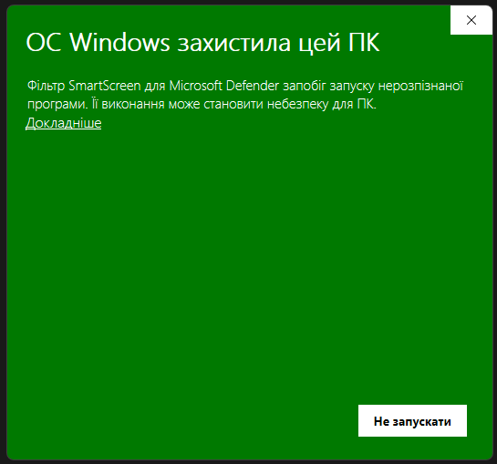

<div align="center">

# 🗺️ SCUM Tactical Map & Real-Time Chat Translator 💬

[](https://github.com/tankow79/scum-ui-translator-map/releases/latest)
[](https://github.com/tankow79/scum-ui-translator-map/releases)
[](https://microsoft.com)
[](https://github.com/tankow79/scum-ui-translator-map/actions/workflows/ci.yml)
[](LICENSE)

**An all-in-one in-game tactical suite for SCUM (Steam): an interactive island map with automatic GPS capture from chat, a sector grid (D0–Z4 / k1–k9), categorized waypoints, and a transparent real-time chat translator overlay.**

🌐 **README languages:** **English** · [Українська](docs/readme/README.uk.md) · [add yours](docs/readme/README.md)

[Quick start](#-quick-start-1-minute) · [Is it a virus?](#-windows-says-protected-your-pc--is-this-a-virus) · [Download](https://github.com/tankow79/scum-ui-translator-map/releases/latest)

</div>

---

## 🚀 Quick start (1 minute)

1. Open the **[latest release](https://github.com/tankow79/scum-ui-translator-map/releases/latest)** and download **`SCUM_Chat_Translator.exe`** (or the `.zip` package, which contains the same exe plus instructions).
2. Put the file into **any folder you like** (for example `C:\Games\SCUM_Translator\`). Do not run it from inside the zip: extract it first.
3. **Double-click `SCUM_Chat_Translator.exe`.**
4. The first time, Windows shows a blue/green **"Windows protected your PC"** window. **This is normal and expected**: follow the 3 clicks in the next section.
5. A blue **`SC`** icon appears in the system tray (next to the clock). Done: the app is running.
6. Start SCUM. The chat translator and the map (`Ctrl + M`) work automatically once the game window is in the foreground.
7. Optional: right-click the tray icon → **Settings** to pick your translation language, hotkeys and overlay look. The **interface language (English / Українська)** is under **Settings → General → Language**.

The app creates its own `config.json`, `points.json` and `profiles.json` next to the exe on first use. You do not need to download or copy them.

---

## 🛡️ Windows says "protected your PC" — is this a virus?

<table>
<tr>
<td>

### ✅ No. This is Windows SmartScreen, and it is normal for new free programs.

**What you see:** *"Windows protected your PC. Microsoft Defender SmartScreen prevented an unrecognized app from starting."*

**Why it appears:** SmartScreen warns about **every** program that is not signed with a paid commercial code-signing certificate and has not yet been downloaded by many people. This project is free, open source and unsigned, so Windows shows the warning for it. **It does not mean a virus was detected.**

**Why it is safe:**
- 🔓 **100 % open source.** Every line of code is in this repository. You can read it or build the exe yourself (see [Build from source](#-build-from-source)).
- 🚫 **No injection, no memory editing, no hooks.** The app only reads SCUM's normal text log file and draws a separate transparent window.
- 🔐 **Verifiable download.** GitHub shows a SHA-256 digest for every file on the release page; you can compare it with your download (`Get-FileHash .\SCUM_Chat_Translator.exe` in PowerShell).
- 🌐 Network use is limited to Google Translate (chat text you choose to translate) and the GitHub Releases API (update check).

</td>
</tr>
</table>

### 🖱️ How to start the program anyway (3 clicks)



*(Screenshot from a Ukrainian Windows. On English Windows the same window says "Windows protected your PC" with a **More info** link and a **Don't run** button.)*

1. In the warning window click **"More info"** (Ukrainian Windows: **"Докладніше"**). The text link is under the description.
2. A new button appears. Click **"Run anyway"** (Ukrainian Windows: **"Виконати все одно"**).
3. The program starts. Windows remembers your choice for this file, so **you will not see the warning again.**

> [!TIP]
> **No "More info" link, or the file will not open at all?** Right-click the `.exe` → **Properties** → at the bottom of the *General* tab tick **Unblock** → **OK**, then start it again.

> [!NOTE]
> **An antivirus removed or blocked the file?** Add the folder with the exe to your antivirus exclusions and download the file again. New unsigned programs are sometimes flagged by heuristics; the source code is here to verify.

> [!IMPORTANT]
> Do **not** disable Windows Defender and do **not** install any "certificate" to run this app. Neither is needed. You only click **More info → Run anyway** once. Download the app only from **this repository's [Releases](https://github.com/tankow79/scum-ui-translator-map/releases)** page.

---

## ⚠️ DISCLAIMER OF LIABILITY

> [!WARNING]
> **IMPORTANT: DISCLAIMER OF LIABILITY!**  
> This software is created strictly for educational, research, and communication accessibility purposes.  
> **The author / developer assumes NO responsibility or liability** for the use of this software, scripts, or binaries, nor for any direct or indirect consequences resulting from its use, including but not limited to:  
> - In-game bans, kicks, or suspensions by Easy Anti-Cheat (EAC) or BattlEye;  
> - Steam or SCUM account penalties or restrictions;  
> - Administrative sanctions or blacklisting on private or official game servers;  
> - Data loss, game crashes, or system instability.  
> 
> **You run and use this software entirely at your own discretion and your own risk!**  
> This application does NOT inject code into game memory (no DLL injection, no process memory editing, no API hooking). It solely reads the standard text log file generated by the game engine (`%LOCALAPPDATA%\SCUM\Saved\Logs\SCUM.log`) and renders an external transparent Windows overlay using official Windows APIs. Nonetheless, users are solely responsible for ensuring compliance with game terms of service and server rules.

---

## 🗺️ Core Feature 1: Interactive Tactical Island Map & GPS Coordinates

The integrated Tactical Map turns SCUM Island navigation and squad coordination into a fast, effortless experience:

### 📍 Key Map Capabilities
* **In-Game Overlay (`Ctrl + M`):** Instantly toggle the tactical map and saved waypoints docked directly on your screen while playing SCUM. Auto-hides when Alt-Tabbing away from the game.
* **Standalone Desktop Map:** Open, inspect, and organize coordinates directly from the Windows System Tray menu anytime, even when SCUM is closed or minimized.
* **In-App Safe Color Dialog:** Custom color picker operates with `WindowStaysOnTopHint`, completely eliminating accidental fullscreen game minimization (Alt-Tab drop).
* **Dual Map Styles:** Switch between high-resolution **Satellite (Regular)** and **Tactical** topographic views.
* **Official SCUM Coordinate Grid:**
  * Sectors: **D0 to Z4** calibrated to game world coordinates.
  * Keypads: **k1 to k9** sub-grid matching standard military calling systems and `scum-map.com`.
  * Real-time cursor coordinates and sector/keypad HUD readout on mouse hover.
* **Automatic GPS Chat Parser:**
  * Automatically detects any in-game coordinates shared in chat formatted as `{X=... Y=... Z=...|...}` (even inside parenthesis or brackets).
  * Extracts the waypoint title from chat prefixes or suffixes (e.g. `car{X=...}`, `{X=...} base`).
* **Smart Category Auto-Detection:**
  * 🏠 **Base** (`#a855f7`): base, home, camp, house;
  * 🚗 **Car** (`#f59e0b`): car, auto, vehicle, suv, truck, pickup;
  * ✈️ **Plane** (`#0ea5e9`): plane, airplane;
  * 🏍️ **Motorcycle** (`#f97316`): moto, motorcycle, bike;
  * 🚤 **Boat** (`#06b6d4`): boat, ship, yacht;
  * 📦 **Cache / Loot** (`#10b981`): cache, loot, chest, stash;
  * 📍 **Default** (`#38bdf8`): generic waypoint marker.
* **Waypoint Management Window:**
  * Visual marker pins with sharp anchor tips placed accurately on coordinates.
  * Instant color picker (Red, Green, Blue, Purple, Gold, Cyan, Orange).
  * Live inline name editing with automatic saving.
  * Player roster tags: assign teammates living or stationed at a base.
  * Search & filter waypoints by name, sector, or player tag.
  * **"On Map"** button: smoothly centers and zooms the map to any pin.
  * **"Copy"** button: copies raw game coordinates to clipboard for sharing.
  * All waypoints persist automatically across sessions in `points.json`.

---

## 💬 Core Feature 2: Real-Time Chat Translator Overlay

Overcome language barriers on international SCUM servers without leaving the game:

### ⚡ Key Translation Capabilities
* **Live In-Game HUD Overlay:** Displays translated chat messages directly over your game screen with customizable background opacity and outline contrast.
* **Squad / Team Highlighting (SCUM Green `#4ade80`):** Messages in squad channels (`[Squad]`, `(Team)`) are automatically identified and colored in vibrant SCUM Green so you never miss teammate callouts.
* **True-to-Game 10s Fade Behavior:** Incoming messages appear, stay visible for a configured timeout (default: 10 seconds), and fade away naturally just like native SCUM chat.
* **Game Chat Synchronization (`T` and `Escape`):**
  * Pressing **`T`** opens SCUM chat, reveals previous chat history on the overlay, and summons the Quick Chat input box.
  * Pressing **`Escape`** instantly dismisses all overlays and immediately restores mouse control and aim back to the game without lag.
* **Zero-Lag Asynchronous Typing (0ms Input Lag):**
  * Fluid 60–144+ FPS typing in the Quick Chat bar with background asynchronous translation.
  * Automatically copies translated text to your clipboard upon pressing **`Enter`**.
  * Paste (`Ctrl + V`) and send directly in SCUM.
* **Two-Way Language Support:** Supports over 100 languages via Google Translate (Ukrainian, English, German, Polish, Spanish, French, Chinese, Turkish, etc.).
* **Instant Blacklist Bypass:** Messages from players on your blacklist bypass external translation API and appear immediately in original text without translation delays.
* **"Map Only" Mode:** Option to completely disable the chat overlay and cease all log file polling, saving CPU cycles and SSD operations.
* **NVIDIA-Style Status Indicator:** Subtle `[● ON]` (green) / `[● OFF]` (red) badge indicating active status.

---

---

## 🌐 Core Feature 3: Language Support (i18n)

* **Language tab in Settings:** Pick the interface language at any time. The app ships in English; every
  `assets/locales/<code>.json` file is discovered automatically, so adding a language needs no code changes
  (see [docs/ADDING_A_LANGUAGE.md](docs/ADDING_A_LANGUAGE.md)). Missing keys fall back to English.
* **Chat translation** supports 100+ languages independently of the interface language.

---

## 🔄 Core Feature 4: 1-Click Auto-Update & 100% Data Preservation

* **Tray notification:** An amber `▲` badge appears on the tray icon when a new release is published on GitHub; the app also re-checks in the background every few hours.
* **Steam-style update window:** compact progress bar with speed and ETA, cancel / retry, release notes on demand.
* **Real one-click install:** the build is downloaded to `%LOCALAPPDATA%\SCUM_Chat_Translator\updates`, verified (size, executable header, SHA-256), swapped in place with automatic rollback, and the app restarts by itself. The Normal / Portable build is matched automatically.
* **Strict user data protection:** `config.json`, `points.json` and `profiles.json` are never overwritten.

---

## 🧰 Core Feature 5: Chat Tools (History, Filters, Profiles)

* **Chat history window** (tray menu): search, filter by player / type / translated-only, export to TXT, CSV or JSON. Optional on-disk persistence with a size limit.
* **Blocked words:** mask them, hide the message or show it untranslated; whole-word and case options.
* **Language auto-detection:** skips translation when a message is already in your language (or in languages you list). Works offline for obvious scripts and uses the translation service's result otherwise.
* **Profiles:** save named presets (translation, filters, overlay look) and switch from Settings or the tray menu.
* **Waypoint import / export** (JSON) with merge or replace.
* Every feature has its own switch in Settings, so each user can tune or disable it.

---

## 🛡️ Core Feature 6: Windows Autostart

* **Seamless Autostart:** Optional startup with Windows via `HKCU\Software\Microsoft\Windows\CurrentVersion\Run` (no admin rights required).

---

---

## ⌨️ In-Game Controls & Hotkeys

| Hotkey | In-Game Action |
|:---:|:---|
| **`Ctrl + M`** | Open / Hide Interactive Tactical SCUM Map & Saved Points list. |
| **`T`** | Open SCUM game chat + open Quick Chat translation box & reveal history. |
| **`Enter`** | Copy translated message to clipboard ➔ close Quick Chat ➔ paste `Ctrl+V` into SCUM. |
| **`Escape`** | Instantly dismiss Quick Chat, Map, or Settings and restore mouse control to SCUM. |
| **`F8`** | Toggle HUD overlay visibility (badge indicates green ON or red OFF state). |
| **`F9`** | Position Setup Mode (Unlock / Lock): drag overlay, resize box, or send a test message. |

---

---

## 🔄 Updating

* When a new version is released, an amber `▲` appears on the tray icon and a notification pops up. Click it (or tray menu → **Update**) and press **Update now**: the app downloads, verifies and installs the new version, then restarts itself. Your settings, waypoints and profiles stay untouched.
* You can also check manually: **Settings → Updates → Check for updates**.
* Updating by hand is just as easy: download the new `.exe` and replace the old one. `config.json`, `points.json` and `profiles.json` live next to the exe and are kept.
* Where files live: downloads go to `%LOCALAPPDATA%\SCUM_Chat_Translator\updates`, the log file to `%LOCALAPPDATA%\SCUM_Chat_Translator\logs\app.log`, chat history to `%LOCALAPPDATA%\SCUM_Chat_Translator\chat_history.jsonl`.

## 🧯 Troubleshooting

| Problem | What to do |
|---|---|
| The program does not start / nothing happens | Look for the blue `SC` icon in the tray (click the `^` arrow). If another copy is running it is already there. See also the SmartScreen steps above. |
| No chat translation in game | Check **Settings → General**: the log path must point to `SCUM.log`, and "Map only" mode must be off. Chat must be sent while the game is running. |
| Overlay is not visible | Press `F8`. Run SCUM in **borderless / windowed** mode (exclusive fullscreen cannot show overlays). |
| Update does not install | Make sure the exe is in a folder you can write to (not `Program Files`). Details are in `%LOCALAPPDATA%\SCUM_Chat_Translator\logs\app.log`. |
| Something else | [Open an issue](https://github.com/tankow79/scum-ui-translator-map/issues/new/choose) and attach the log file (remove private data). |

---

## 🧑‍💻 Build from source

Requirements: Windows 10/11 (64-bit), Python 3.10–3.13, Git.

```powershell
git clone https://github.com/tankow79/scum-ui-translator-map.git
cd scum-ui-translator-map
python -m venv .venv
.\.venv\Scripts\Activate.ps1
pip install -r requirements-dev.txt
python main.py          # or double-click run.bat
```

Checks and build:

```powershell
python -m ruff check .
python -m pytest
python -m PyInstaller --noconfirm SCUM_Chat_Translator.spec     # -> dist\SCUM_Chat_Translator.exe
```

See [CONTRIBUTING.md](CONTRIBUTING.md), [docs/ARCHITECTURE.md](docs/ARCHITECTURE.md) and [docs/ADDING_A_LANGUAGE.md](docs/ADDING_A_LANGUAGE.md).

---

## ⚙️ Configuration Guide (`config.json`)

| Parameter | Type | Default | Description |
|---|:---:|:---:|---|
| `log_file_path` | string | `%LOCALAPPDATA%\SCUM\...` | Path to SCUM game log file. Resolves environment variables automatically. |
| `target_language` | string | `"uk"` | Language for translating incoming game chat messages. |
| `source_language` | string | `"auto"` | Original chat language (`auto` for auto-detection). |
| `outgoing_my_lang` | string | `"uk"` | Your native language for outgoing Quick Chat (`T`). |
| `outgoing_target_lang` | string | `"en"` | Target language your typed messages are translated into. |
| `message_fade_timeout` | int | `10` | Message display duration on HUD in seconds (0 = never fade). |
| `font_size` | int | `18` | Font size of chat overlay. |
| `font_bold` | bool | `true` | Bold font weight for enhanced contrast against game background. |
| `text_outline` | bool | `true` | High-contrast black outline around HUD text. |
| `bg_opacity` | float | `0.0` | Background opacity (0.0 = completely transparent). |
| `own_nickname` | string | `""` | Your in-game character nickname. |
| `ignore_own_messages` | bool | `false` | Skip translating your own messages. |
| `blacklist_nicknames` | list | `[]` | List of player nicknames to hide from the chat overlay. |
| `hotkey_toggle_map` | string | `"Ctrl+M"` | Hotkey to toggle the Interactive Tactical Map and Points list. |
| `hotkey_quick_chat` | string | `"T"` | Hotkey to open in-game chat and quick translator. |
| `hotkey_toggle_visibility`| string | `"F8"` | Hotkey to hide / unhide chat overlay. |
| `hotkey_toggle_lock` | string | `"F9"` | Hotkey to unlock / lock overlay for moving and resizing. |
| `map_variant` | string | `"regular"` | Map style (`regular` for satellite, `tactical` for tactical topo). |
| `map_show_grid` | bool | `true` | Show D0..Z4 sector grid lines. |
| `map_show_keypads` | bool | `true` | Show k1..k9 keypad sub-grid lines. |
| `auto_focus_new_point` | bool | `true` | Automatically pan and focus map on newly detected coordinates. |
| `enable_chat_translator`| bool | `true` | Toggle chat translator overlay (uncheck for pure "Map Only" mode). |
| `ui_language` | string | `"en"` | Interface language code (any file in `assets/locales/`). |
| `auto_start` | bool | `true` | Automatically start application with Windows boot. |
| `auto_check_updates` | bool | `true` | Check for updates automatically in background on launch. |
| `update_check_interval_hours` | int | `6` | Background update re-check interval (`0` = only at startup). |
| `blacklist_words_enabled` | bool | `false` | Enable the blocked-word filter. |
| `blacklist_words` | list | `[]` | Blocked words / phrases. |
| `blacklist_words_action` | string | `"mask"` | `mask`, `hide` or `no_translate`. |
| `blacklist_words_whole_word` | bool | `true` | Match whole words only. |
| `blacklist_words_case_sensitive` | bool | `false` | Case-sensitive matching. |
| `autodetect_enabled` | bool | `true` | Skip translation for messages already in an excluded language. |
| `autodetect_skip_target_language` | bool | `true` | Treat your target language as "no translation needed". |
| `autodetect_skip_languages` | list | `[]` | Extra language codes to skip. |
| `autodetect_min_length` | int | `3` | Minimum letters before detection is attempted. |
| `history_enabled` | bool | `true` | Record chat history. |
| `history_save_to_disk` | bool | `true` | Keep history between sessions. |
| `history_max_entries` | int | `5000` | Maximum stored messages. |

---

<br>

---

## 📄 License

[MIT](LICENSE). Changes between versions: [CHANGELOG.md](CHANGELOG.md).
