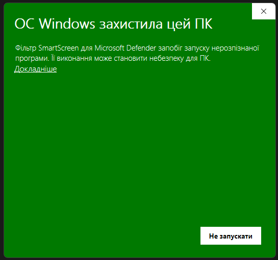

<div align="center">

# 🗺️ SCUM Tactical Map & Real-Time Chat Translator 💬

[](https://github.com/tankow79/scum-ui-translator-map/releases/latest)
[](https://github.com/tankow79/scum-ui-translator-map/releases)
[](https://microsoft.com)
[](../../LICENSE)

**Тактичний набір для SCUM (Steam): інтерактивна карта острова з автоматичним збором GPS-координат із чату, сітка секторів (D0–Z4 / k1–k9), категорії міток і прозорий оверлей перекладу чату в реальному часі.**

🌐 **Мови README:** [English](../../README.md) · **Українська**

[Швидкий старт](#-швидкий-старт-1-хвилина) · [Це вірус?](#-windows-пише-захистила-цей-пк--це-вірус) · [Завантажити](https://github.com/tankow79/scum-ui-translator-map/releases/latest)

</div>

---

## 🚀 Швидкий старт (1 хвилина)

1. Відкрийте **[останній реліз](https://github.com/tankow79/scum-ui-translator-map/releases/latest)** і завантажте **`SCUM_Chat_Translator.exe`** (або `.zip`: у ньому той самий exe та інструкція).
2. Покладіть файл у **будь-яку папку** (наприклад `C:\Games\SCUM_Translator\`). Не запускайте його всередині архіву: спершу розпакуйте.
3. **Двічі клацніть `SCUM_Chat_Translator.exe`.**
4. Перший раз Windows покаже синє/зелене вікно **«ОС Windows захистила цей ПК»**. **Це нормально й очікувано**: виконайте 3 кліки з наступного розділу.
5. Біля годинника (у треї) з'явиться синя іконка **`SC`**. Готово: програма працює.
6. Запустіть SCUM. Переклад чату та карта (`Ctrl + M`) працюють автоматично, щойно вікно гри на передньому плані.
7. Необов'язково: клацніть правою кнопкою на іконці в треї → **Settings** (Налаштування). Там можна обрати мову перекладу, гарячі клавіші та вигляд оверлея. **Мову інтерфейсу (English / Українська)** змінюють у **Settings → General → Language**.

Програма сама створює `config.json`, `points.json` і `profiles.json` поруч з exe при першому використанні. Завантажувати чи копіювати їх не потрібно.

---

## 🛡️ Windows пише «захистила цей ПК» — це вірус?

<table>
<tr>
<td>

### ✅ Ні. Це Windows SmartScreen, і це нормально для нових безкоштовних програм.

**Що ви бачите:** *«ОС Windows захистила цей ПК. Фільтр SmartScreen для Microsoft Defender запобіг запуску нерозпізнаної програми.»*

**Чому це з'являється:** SmartScreen попереджає про **кожну** програму, яка не підписана платним комерційним сертифікатом розробника й ще не завантажена великою кількістю людей. Цей проєкт безкоштовний, з відкритим кодом і без підпису, тому Windows показує попередження. **Це не означає, що знайдено вірус.**

**Чому це безпечно:**
- 🔓 **100 % відкритий код.** Кожен рядок коду лежить у цьому репозиторії. Його можна прочитати або зібрати exe самостійно (див. [Збірка з коду](#-збірка-з-вихідного-коду)).
- 🚫 **Жодних ін'єкцій, редагування пам'яті чи хуків.** Програма лише читає звичайний текстовий журнал SCUM і малює окреме прозоре вікно.
- 🔐 **Перевірене завантаження.** GitHub показує SHA-256 кожного файлу на сторінці релізу; його можна порівняти зі своїм (`Get-FileHash .\SCUM_Chat_Translator.exe` у PowerShell).
- 🌐 Мережа використовується лише для Google Translate (текст чату, який ви перекладаєте) та GitHub Releases API (перевірка оновлень).

</td>
</tr>
</table>

### 🖱️ Як усе одно запустити програму (3 кліки)



1. У вікні попередження натисніть **«Докладніше»** (в англійській Windows: **More info**). Це текстове посилання під описом.
2. З'явиться нова кнопка. Натисніть **«Виконати все одно»** (англійською: **Run anyway**).
3. Програма запуститься. Windows запам'ятає ваш вибір для цього файлу, тож **попередження більше не повториться.**

> [!TIP]
> **Немає посилання «Докладніше» або файл взагалі не відкривається?** Клацніть exe правою кнопкою → **Властивості** → внизу вкладки *Загальні* поставте галочку **Розблокувати** → **OK**, потім запустіть знову.

> [!NOTE]
> **Антивірус видалив або заблокував файл?** Додайте папку з exe до винятків антивіруса й завантажте файл знову. Нові непідписані програми іноді спрацьовують на евристику; вихідний код відкритий для перевірки.

> [!IMPORTANT]
> **Не** вимикайте Windows Defender і **не** встановлюйте жодних «сертифікатів», щоб запустити цю програму. Ні те, ні інше не потрібне. Достатньо один раз натиснути **Докладніше → Виконати все одно**. Завантажуйте програму лише зі сторінки **[Releases](https://github.com/tankow79/scum-ui-translator-map/releases)** цього репозиторію.

---

## ⚠️ ВІДМОВА ВІД ВІДПОВІДАЛЬНОСТІ (DISCLAIMER)

> [!WARNING]
> **УВАГА: ВІДМОВА ВІД ВІДПОВІДАЛЬНОСТІ!**  
> Даний програмний продукт створено виключно з пізнавальною, освітньою метою та для полегшення міжмовної комунікації гравців.  
> **Автор / розробник проєкту НЕ несе жодної відповідальності** за використання даного скрипта, програми чи її модифікацій, а також за будь-які можливі прямі чи непрямі наслідки:  
> - Блокування (бани) античітом Easy Anti-Cheat (EAC) або BattlEye;  
> - Обмеження або блокування облікового запису Steam / SCUM;  
> - Санкції з боку адміністраторів серверів або розробників гри Gamepires / Jagex;  
> - Помилки, збої або втрату ігрових даних.  
> 
> **Ви використовуєте дане програмне забезпечення виключно на свій власний розсуд і ризик!**  
> Програма НЕ здійснює ін'єкцій у пам'ять процесу гри (Memory Injection / DLL Hooking), а лише зчитує стандартний текстовий файл ігрового журналу (`%LOCALAPPDATA%\SCUM\Saved\Logs\SCUM.log`) та використовує стандартні функції Windows API для показу прозорого оверлею. Проте рішення про використання залишається на вашій відповідальності.

---

## 🗺️ Ключова можливість 1: Інтерактивна тактична карта острова та координати

Інтерактивна тактична карта виводить орієнтування на острові SCUM та координацію команди на новий рівень:

### 📍 Можливості карти
* **Швидкий виклик у грі (`Ctrl + M`):** Миттєво відкриває інтерактивну карту острова та панель збережених точок координат. Працює у грі та автоматично ховається при згортанні (Alt+Tab).
* **Автономний запуск з трею:** Відкривайте та редагуйте тактичну карту та координати в будь-який момент без запущеної гри SCUM прямо з меню біля годинника!
* **Безпечна вбудована палітра кольорів:** Вікно вибору кольору шпильки працює в режимі поверх екрана (`WindowStaysOnTopHint`), запобігаючи випадковому згортанню гри у повноекранному режимі.
* **Два стилі відображення карти:** Швидке перемикання між **Супутниковою (Regular)** та **Тактичною** топографічною картою високої роздільної здатності.
* **Офіційна координатна сітка SCUM:**
  * Сектори: **від D0 до Z4**, математично точно прив'язані до світових координат Unreal Engine.
  * Кейпади: підсітка **k1–k9** відповідно до стандартів гри та сервісу `scum-map.com`.
  * Відображення ігрових координат, поточного сектора та кейпаду в реальному часі при наведенні курсору.
* **Автоматичний перехоплювач координат із чату:**
  * Автоматично розпізнає будь-які координати, надіслані гравцями в чат у форматі `{X=... Y=... Z=...|...}`.
  * Витягує підпис мітки з тексту повідомлення перед або після координат.
* **Розумне автовизначення категорій міток:**
  * 🏠 **База** (`#a855f7`): база, дом, хата, base, camp;
  * 🚗 **Машина** (`#f59e0b`): машина, авто, тачка, car, suv, truck, пікап;
  * ✈️ **Літак** (`#0ea5e9`): літак, самолет, plane, авіа;
  * 🏍️ **Мотоцикл** (`#f97316`): мото, мотоцикл, байк, bike;
  * 🚤 **Лодка** (`#06b6d4`): лодка, човен, катер, boat, яхта;
  * 📦 **Схрон / Лут** (`#10b981`): схрон, лут, ящик, cache, stash;
  * 📍 **Мітка** (`#38bdf8`): звичайна точка інтересу.
* **Зручна панель керування точками:**
  * Візуальні шпильки (pins) із гострим вістрям точно на координатах.
  * Вибір кольору шпильки в один клік (червоний, зелений, синій, золото, фіолетовий тощо).
  * Редагування назви точки на льоту з миттєвим автозбереженням.
  * Список гравців (жителів бази / загону).
  * Пошук та фільтрація точок за назвою, сектором або нікнеймом гравця.
  * Кнопка **«На карті»** — плавно центрує та наближає карту до вибраної мітки.
  * Кнопка **«Копіювати»** — копіює повні координати в буфер обміну для надсилання в чат.
  * Усі мітки надійно зберігаються у файлі `points.json` між сесіями.

---

## 💬 Ключова можливість 2: Синхронний перекладач чату в реальному часі

Зручне спілкування на міжнародних серверах без мовного бар'єру:

### ⚡ Можливості перекладача
* **Прозорий ігровий HUD-оверлей:** Відображає перекладені повідомлення поверх гри з налаштовуваною прозорістю фону та контрастною обводкою літер.
* **Зелена підсвітка скваду (SCUM Green `#4ade80`):** Повідомлення від сокомандників (`[Squad]`, `(Team)`) автоматично підсвічуються яскравим фірмовим зеленим кольором гри.
* **Точна поведінка оригінального чату SCUM:** Кожне повідомлення живе налаштований час (за замовчуванням 10 секунд) і плавно зникає.
* **Синхронізація з клавішами `T` та `Escape`:**
  * Натискання **`T`** у грі відкриває чат SCUM, розкриває історію повідомлень та активує вікно швидкого введення.
  * Натискання **`Escape`** миттєво ховає оверлей і вікно вводу, повертаючи фокус та керування мишкою безпосередньо у гру без затримок.
* **Плавне введення тексту (0ms Lag):**
  * Повністю асинхронний живий переклад у фоновому потоці — жодних підвисань при швидкому наборі тексту.
  * Натискання **`Enter`** автоматично копіює переклад у буфер обміну ➔ вставляйте `Ctrl+V` у гру!
* **Понад 100 мов:** Підтримка Google Translate для будь-яких мовних пар.
* **Миттєвий чорний список (Blacklist):** Повідомлення від заблокованих гравців не відправляються на переклад і показуються мовою оригіналу без затримок.
* **Режим «Тільки Карта»:** Можливість повністю вимкнути HUD-перекладач та зупинити читання логу SCUM.log (0% навантаження на диск і CPU).
* **Індикатор статусу NVIDIA-style:** Зелений `[● ON]` / червоний `[● OFF]` значок у кутку екрана.

---

## 🌐 Ключова можливість 3: Мови інтерфейсу (i18n)

* **Вкладка «Language» у налаштуваннях:** мову інтерфейсу можна змінити будь-коли. Програма постачається англійською та українською; кожен файл `assets/locales/<код>.json` підхоплюється автоматично, тож додати мову можна без змін у коді ([docs/ADDING_A_LANGUAGE.md](../ADDING_A_LANGUAGE.md)). Відсутні ключі беруться з англійської.
* **Переклад чату** працює для 100+ мов незалежно від мови інтерфейсу.

---

## 🔄 Ключова можливість 4: Автооновлення в 1 клік та збереження даних

* **Сповіщення в треї:** помаранчевий значок `▲` з'являється, коли на GitHub виходить новий реліз; програма також перевіряє оновлення у фоні.
* **Вікно оновлення в стилі Steam:** компактна смуга прогресу зі швидкістю та залишком часу, «Скасувати» / «Повторити», нотатки релізу за запитом.
* **Справжнє оновлення в один клік:** збірка завантажується до `%LOCALAPPDATA%\SCUM_Chat_Translator\updates`, перевіряється (розмір, заголовок, SHA-256), підміняється на місці з автоматичним відкатом, після чого програма перезапускається. Звичайна / Portable збірка визначається автоматично.
* **100% збереження даних:** `config.json`, `points.json` та `profiles.json` ніколи не перезаписуються.

---

## 🧰 Ключова можливість 5: Інструменти чату (історія, фільтри, профілі)

* **Історія чату** (меню трею): пошук, фільтри за гравцем / типом / лише перекладені, експорт у TXT, CSV або JSON.
* **Заборонені слова:** маскування, приховування повідомлення або показ без перекладу.
* **Автовизначення мови:** пропускає переклад, якщо повідомлення вже вашою мовою (або мовами зі списку).
* **Профілі налаштувань** з перемиканням у налаштуваннях або в треї.
* **Імпорт / експорт точок** (JSON) зі злиттям або заміною.
* Кожна функція має власний перемикач у налаштуваннях.

---

## 🛡️ Ключова можливість 6: Автозапуск Windows

* **Зручний автозапуск:** необов'язковий запуск разом з Windows через `HKCU\Software\Microsoft\Windows\CurrentVersion\Run` (права адміністратора не потрібні).

---

## ⌨️ Керування та гарячі клавіші

| Клавіша | Дія у грі |
|:---:|:---|
| **`Ctrl + M`** | Відкрити / сховати інтерактивну Карту SCUM та список збережених точок координат. |
| **`T`** | Відкрити чат у SCUM + відкрити поле швидкого перекладу та розгорнути історію. |
| **`Enter`** | Скопіювати перекладений текст у буфер обміну ➔ закрити вікно перекладу ➔ вставити `Ctrl+V` у гру. |
| **`Escape`** | Миттєво закрити вікно перекладу, карту чи налаштування та без затримок повернути мишку в гру. |
| **`F8`** | Показати / Приховати оверлей чату (індикатор показує зелений або червоний стан). |
| **`F9`** | Режим налаштування (Розблокувати / Зафіксувати): перетягування оверлею мишкою, зміна розміру, тест. |

---

## 🔄 Оновлення

* Коли виходить нова версія, на іконці в треї з'являється помаранчевий `▲` і спливає сповіщення. Клацніть його (або меню трею → **Update**) і натисніть **«Оновити зараз»**: програма завантажить, перевірить і встановить нову версію та сама перезапуститься. Налаштування, мітки й профілі не зачіпаються.
* Перевірити вручну: **Settings → General → Updates → Check for updates**.
* Оновити вручну так само просто: завантажте новий `.exe` і замініть старий. `config.json`, `points.json` і `profiles.json` лежать поруч з exe і зберігаються.
* Де що лежить: завантаження оновлень у `%LOCALAPPDATA%\SCUM_Chat_Translator\updates`, журнал у `%LOCALAPPDATA%\SCUM_Chat_Translator\logs\app.log`, історія чату в `%LOCALAPPDATA%\SCUM_Chat_Translator\chat_history.jsonl`.
* Перед оновленням програма робить перевірену резервну копію ваших файлів; після успішного запуску копія видаляється сама. Якщо файл зник або пошкодився, його буде відновлено.

## 🧯 Вирішення проблем

| Проблема | Що робити |
|---|---|
| Програма не запускається / нічого не відбувається | Пошукайте синю іконку `SC` у треї (стрілка `^`). Якщо вже запущена інша копія, іконка вже там. Також дивіться кроки SmartScreen вище. |
| Немає перекладу чату в грі | У **Settings → Chat** перевірте мову перекладу; у **Settings → General** шлях має вказувати на `SCUM.log`, а режим «тільки карта» має бути вимкнений. |
| Оверлей не видно | Натисніть `F8`. Запускайте SCUM у режимі **вікно без рамки / віконному** (ексклюзивний повний екран не показує оверлеї). |
| Оновлення не встановлюється | Exe має лежати в папці, куди можна писати (не `Program Files`). Подробиці в `%LOCALAPPDATA%\SCUM_Chat_Translator\logs\app.log`. |
| Щось інше | [Створіть issue](https://github.com/tankow79/scum-ui-translator-map/issues/new/choose) і додайте журнал (приберіть приватні дані). |

---

## 🧑‍💻 Збірка з вихідного коду

Потрібно: Windows 10/11 (64-bit), Python 3.10–3.13, Git.

```powershell
git clone https://github.com/tankow79/scum-ui-translator-map.git
cd scum-ui-translator-map
python -m venv .venv
.\.venv\Scripts\Activate.ps1
pip install -r requirements-dev.txt
python main.py          # або двічі клацніть run.bat
```

Перевірки та збірка:

```powershell
python -m ruff check .
python -m pytest
python -m PyInstaller --noconfirm SCUM_Chat_Translator.spec     # -> dist\SCUM_Chat_Translator.exe
```

Дивіться [CONTRIBUTING.md](../../CONTRIBUTING.md), [docs/ARCHITECTURE.md](../ARCHITECTURE.md) та [docs/ADDING_A_LANGUAGE.md](../ADDING_A_LANGUAGE.md).

---

## ⚙️ Таблиця параметрів налаштування (`config.json`)

| Параметр | Тип | За замовчуванням | Опис |
|---|:---:|:---:|---|
| `log_file_path` | string | `%LOCALAPPDATA%\SCUM\...` | Шлях до журналу SCUM.log (підтримує змінні оточення Windows). |
| `target_language` | string | `"uk"` | Мова перекладу вхідного чату SCUM. |
| `source_language` | string | `"auto"` | Мова оригіналу повідомлень (`auto` для автовизначення). |
| `outgoing_my_lang` | string | `"uk"` | Ваша рідна мова для швидкого вводу через Quick Chat (`T`). |
| `outgoing_target_lang` | string | `"en"` | Мова, на яку перекладатиметься ваш текст для відправки в гру. |
| `message_fade_timeout` | int | `10` | Час показу повідомлення на екрані у секундах (0 = ніколи не ховати). |
| `font_size` | int | `18` | Розмір шрифту оверлею. |
| `font_bold` | bool | `true` | Жирний шрифт для підвищення читабельності на тлі гри. |
| `text_outline` | bool | `true` | Контрастна чорна обводка навколо тексту. |
| `bg_opacity` | float | `0.0` | Прозорість фонової підкладки оверлею (0.0 = повністю прозорий). |
| `own_nickname` | string | `""` | Ваш нікнейм у грі (для розпізнавання власних повідомлень). |
| `ignore_own_messages` | bool | `false` | Ігнорувати переклад власних повідомлень. |
| `blacklist_nicknames` | list | `[]` | Список нікнеймів для показу без затримок мовою оригіналу. |
| `hotkey_toggle_map` | string | `"Ctrl+M"` | Гаряча клавіша відкриття тактичної карти та списку точок. |
| `hotkey_quick_chat` | string | `"T"` | Гаряча клавіша відкриття чату та вікна швидкого перекладу. |
| `hotkey_toggle_visibility`| string | `"F8"` | Гаряча клавіша приховування / показу оверлею. |
| `hotkey_toggle_lock` | string | `"F9"` | Режим розблокування оверлею для зміни положення мишкою. |
| `map_variant` | string | `"regular"` | Стиль карти (`regular` — супутникова, `tactical` — тактична). |
| `map_show_grid` | bool | `true` | Відображення координатної сітки секторів D0..Z4. |
| `map_show_keypads` | bool | `true` | Відображення підсітки кейпадів k1..k9. |
| `auto_focus_new_point` | bool | `true` | Автоматичне фокусування карти на нових координатах із чату. |
| `enable_chat_translator`| bool | `true` | Увімкнення перекладача чату (вимкніть для режиму «Тільки Карта»). |
| `ui_language` | string | `"en"` | Код мови інтерфейсу (будь-який файл у `assets/locales/`). |
| `auto_start` | bool | `true` | Безпечний автозапуск програми разом із Windows. |
| `auto_check_updates` | bool | `true` | Автоматична фонова перевірка оновлень при запуску. |
| `update_check_interval_hours` | int | `6` | Інтервал фонової перевірки оновлень у годинах (`0` = лише при запуску). |
| `blacklist_words_enabled` | bool | `false` | Увімкнути фільтр заборонених слів. |
| `blacklist_words` | list | `[]` | Заборонені слова / фрази. |
| `blacklist_words_action` | string | `"mask"` | `mask` (замінити на ***), `hide` (приховати) або `no_translate` (без перекладу). |
| `blacklist_words_whole_word` | bool | `true` | Лише цілі слова. |
| `blacklist_words_case_sensitive` | bool | `false` | Враховувати регістр. |
| `autodetect_enabled` | bool | `true` | Не перекладати повідомлення, що вже написані непотрібною вам мовою. |
| `autodetect_skip_target_language` | bool | `true` | Вважати вашу мову перекладу такою, що не потребує перекладу. |
| `autodetect_skip_languages` | list | `[]` | Додаткові коди мов для пропуску. |
| `autodetect_min_length` | int | `3` | Мінімум літер, щоб спробувати визначити мову. |
| `history_enabled` | bool | `true` | Записувати історію чату. |
| `history_save_to_disk` | bool | `true` | Зберігати історію між сеансами. |
| `history_max_entries` | int | `5000` | Максимум збережених повідомлень. |

---

## 📄 Ліцензія

[MIT](../../LICENSE). Зміни між версіями: [CHANGELOG.md](../../CHANGELOG.md).
