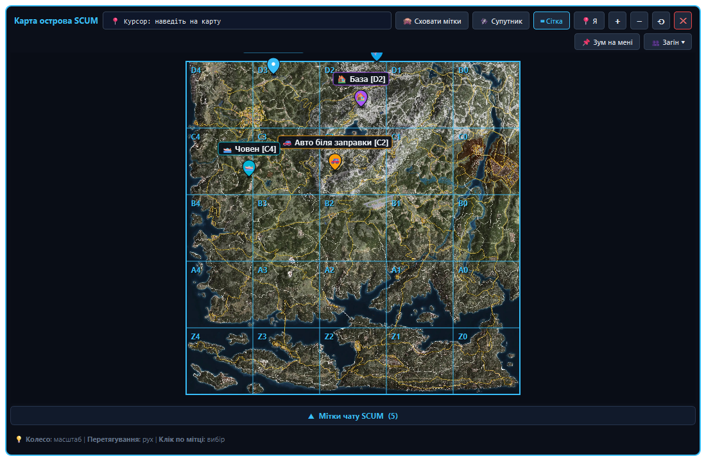
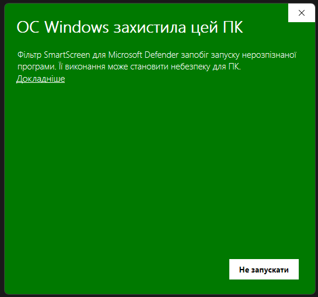
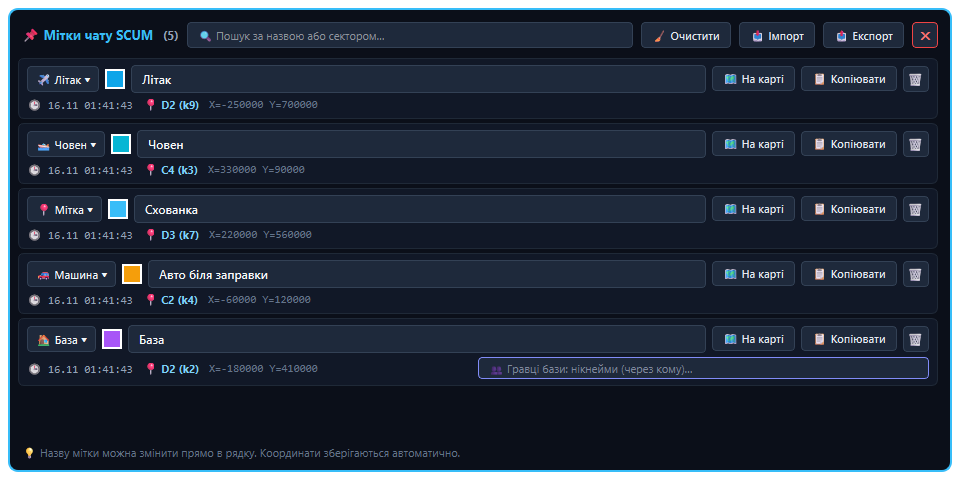
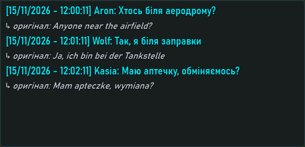
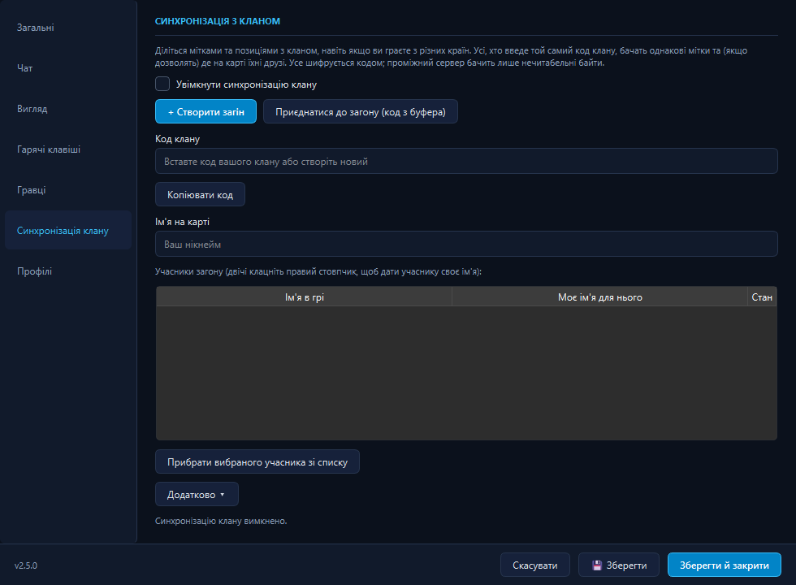
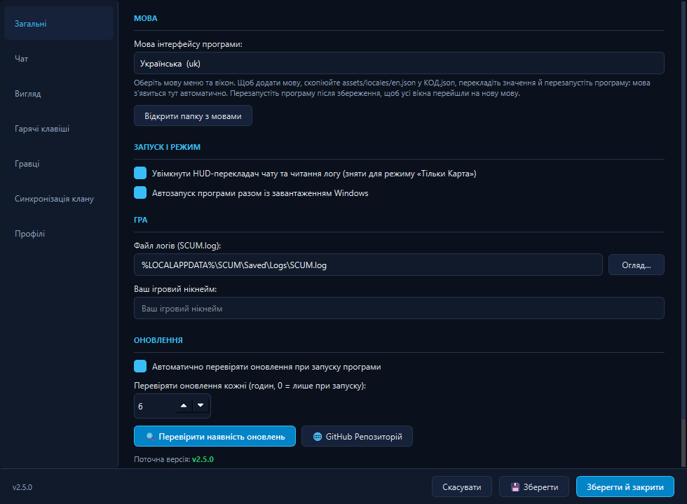

<div align="center">

# SCUM Tactical Map & Chat Translator

[](https://github.com/tankow79/scum-ui-translator-map/releases/latest)
[](https://github.com/tankow79/scum-ui-translator-map/releases)
[](https://microsoft.com)
[](../../LICENSE)

Безкоштовний оверлей для SCUM (Steam) на Windows. Перекладає ігровий чат на льоту, перетворює координати з чату на мітки на карті острова й вміє ділитися цими мітками та вашою позицією з друзями.

[English](../../README.md) · **Українська**

</div>



## Встановлення

1. Завантажте `SCUM_Chat_Translator.exe` з [останнього релізу](https://github.com/tankow79/scum-ui-translator-map/releases/latest). У `.zip` лежить той самий exe та коротка інструкція. Якщо берете архів, спершу розпакуйте його.
2. Покладіть exe у папку, куди можна писати, наприклад `C:\Games\SCUM_Translator\`. Не в `Program Files` і не всередину архіву.
3. Двічі клацніть по ньому. Біля годинника в треї з'явиться синя іконка `SC`. Це й увесь застосунок.
4. Запустіть SCUM. Переклад чату та карта (`Ctrl + M`) працюють, щойно вікно гри на передньому плані.

Під час першого запуску Windows може показати «ОС Windows захистила цей ПК». Натисніть **Докладніше**, потім **Виконати все одно**. Це один раз для кожного файлу. Деталі нижче.

При першому старті мова інтерфейсу береться з Windows: в українській Windows програма українською, у решті випадків англійською. Змінити можна будь-коли в **Settings → General → Language** (**Налаштування → Загальні → Мова**).

Поруч з exe програма сама створить `config.json`, `points.json`, `profiles.json` і `players.json`. Більше нічого копіювати чи налаштовувати не треба. Запускайте SCUM у віконному режимі без рамки або у віконному, бо ексклюзивний повноекранний режим не показує оверлеї.

## Це вірус?

Ні. SmartScreen попереджає про кожну програму, що не має платного сертифіката підпису й ще не має багато завантажень. Проєкт безкоштовний і непідписаний, тому Windows скаржиться. Це не означає, що щось знайдено.

Чому цьому можна довіряти: увесь код лежить у цьому репозиторії, і exe можна зібрати самому. Програма нічого не вбудовує в гру, не чіпає її пам'ять і не ставить хуки. Вона читає звичайний текстовий журнал SCUM і малює власне прозоре вікно. У мережу вона виходить лише до Google Translate (текст чату, який ви перекладаєте), GitHub Releases API (перевірка оновлень) і, якщо ви ввімкнете, до реле-серверів синхронізації клану. GitHub показує SHA-256 для кожного файлу релізу, тож його можна звірити з `Get-FileHash .\SCUM_Chat_Translator.exe`.



У вікні натисніть **«Докладніше»**, потім **«Виконати все одно»**. Windows запам'ятає вибір, і попередження більше не повториться.

Немає посилання «Докладніше» або файл узагалі не відкривається: клацніть exe правою кнопкою, оберіть **Властивості**, внизу вкладки «Загальні» поставте галочку **Розблокувати**, натисніть OK і спробуйте ще раз. Якщо антивірус видаляє файл, додайте папку до винятків і завантажте файл знову. Не вимикайте Defender і не ставте жодних сертифікатів: це не потрібно. Беріть програму лише зі сторінки [Releases](https://github.com/tankow79/scum-ui-translator-map/releases) цього репозиторію.

## Відмова від відповідальності

Програма створена для навчання, досліджень і щоб зробити чат доступнішим. Автор не відповідає ні за що, що станеться через її використання, зокрема за блокування від Easy Anti-Cheat чи BattlEye, санкції щодо акаунтів або серверів, втрату даних чи збої. Ви користуєтеся нею на власний ризик і самі відповідаєте за дотримання правил гри та вашого сервера.

Для ясності: жодної DLL-ін'єкції, жодного редагування пам'яті процесу, жодних хуків API. Програма лише читає журнал, який пише гра (`%LOCALAPPDATA%\SCUM\Saved\Logs\SCUM.log`), і показує зовнішнє вікно.

## Карта



Натисніть `Ctrl + M` у грі, і карта відкриється поверх екрана. Коли ви перемикаєтеся Alt-Tab, вона сама ховається. Відкрити її можна й із меню в треї, навіть коли SCUM закрито.

Коли хтось пише в чат координати на кшталт `авто {X=174468 Y=345933 Z=34103}`, програма підхоплює їх і ставить мітку. Слово біля координат стає назвою, а за ним визначається категорія: база, авто, літак, мотоцикл, човен, схованка або звичайна мітка. Сітка офіційна: сектори D0–Z4 і кейпади k1–k9, а сектор видно, коли водиш курсором. Є два стилі: супутниковий і тактичний.

Список міток — це шухляда під картою. Клацніть по смужці внизу, і вона виїде вгору. Назву мітки можна змінити прямо в її рядку, так само колір і категорію. Є пошук за назвою чи сектором, кнопка **На карті** переносить до мітки, а **Копіювати** кладе ігрові координати в буфер. Усе зберігається в `points.json`, а мітки можна імпортувати й експортувати у JSON.

До баз можна вписати нікнейми тих, хто там живе. Програма зіставляє їх зі SteamID із журналу гри й стежить за перейменуваннями, тож база не губить власників, коли ті змінюють ім'я. Наведіть на базу, щоб їх побачити.

Кнопка **Я** наближає до вашої позиції, **Загін** — до друга, а **Сховати мітки** це режим PvP: прибирає мітки й список, лишаються тільки гравці.

## Перекладач чату



Чат з'являється поверх гри, а під кожним рядком стоїть оригінал. Вигляд скопійовано з ігрового чату (шрифт Bahnschrift, чорний контур, той самий формат часу), а за замовчуванням повідомлення зникає за 10 секунд. Бійці загону, яких ви вписали в **Налаштування → Чат → Гравці**, світло-зелені, решта гравців сині, повідомлення сервера жовті. Журнал гри не каже, з якого каналу повідомлення, тому локальний і глобальний чат виглядають однаково.

Натисніть `T`, і відкриється ігровий чат разом зі швидким полем вводу. Пишіть своєю мовою, а переклад потрапляє в буфер, коли ви тиснете `Enter`. Вставте його в гру через `Ctrl + V`. Друкувати комфортно, бо переклад іде у фоні. `Escape` усе закриває й повертає мишу грі.

Перекладається понад 100 мов через Google Translate, незалежно від мови інтерфейсу. Повідомлення вашою мовою пропускаються. Гравці з чорного списку з'являються миттєво в оригіналі, а заборонені слова можна замаскувати, сховати чи лишити без перекладу. Якщо потрібна тільки карта, увімкніть «Тільки карта», і програма взагалі перестане читати журнал.

У меню в треї також є вікно історії чату з пошуком, фільтрами та експортом у TXT, CSV чи JSON, і профілі: іменовані набори налаштувань перекладу, фільтрів і вигляду оверлея.

## Синхронізація клану



Друзі з різних країн можуть ділитися мітками й бачити одне одного на карті. Хтось один тисне **Створити загін** в **Налаштування → Синхронізація клану** й надсилає код іншим, а вони тиснуть **Приєднатися до загону**. Далі всі бачать однакові мітки: додавання, перейменування, зміна кольору й видалення приходять наживо. Хто приєднався пізніше, отримає все, а зміни, зроблені офлайн, підуть, щойно повернеться зв'язок. Якщо двоє правлять одну мітку, перемагає новіша правка.

Щоб показати свою позицію, натисніть у грі `Ctrl + C`. Гра копіює координати в буфер, програма їх читає, а друзі бачать ваш маркер з іменем і напрямком. Коли дані старішають, він згасає. Є необов'язковий режим «натискати Ctrl+C за мене», за замовчуванням вимкнений: якщо турбуєтеся про античіт, не вмикайте. У таблиці учасників кожному другові можна дати власне ім'я: ви називаєте когось Андрієм, а він вас Олегом.

Хостити сервер не треба. Програма використовує публічні MQTT-реле як зашифровану скриньку, говорить із двома одночасно й відкидає дублікати, тож один мертвий сервер не відрізає загін. Реле бачать лише нечитабельні байти. Власне реле можна вказати в додаткових параметрах.

Пам'ятайте, що код клану це спільний секрет. Хто його має, може читати мітки загону й додавати свої, тож давайте його лише тим, кому довіряєте. Приєднання до загону також публікує мітки, які у вас вже є, а **Очистити все** очищає їх у всіх.

## Налаштування



Клацніть правою кнопкою по іконці в треї й відкрийте **Налаштування**. **Зберегти** лишає вікно відкритим, **Зберегти й закрити** закриває його. У кожної функції є свій перемикач, тож усе непотрібне можна вимкнути. Сторінка «Гравці» зберігає кожен нікнейм, який показав журнал гри, прив'язаний до постійного SteamID, з історією старих імен. Збір можна вимкнути, а кожне видалення спершу питає підтвердження.

## Гарячі клавіші

| Клавіша | Що робить |
|:---:|:---|
| `Ctrl + M` | Показати або сховати карту й список міток |
| `T` | Відкрити ігровий чат і швидке поле перекладу |
| `Enter` | Скопіювати переклад, закрити поле, далі вставити через `Ctrl + V` |
| `Escape` | Закрити поле, карту чи налаштування й повернути мишу грі |
| `F8` | Показати або сховати оверлей чату |
| `F9` | Розблокувати оверлей, щоб тягти й змінювати розмір, і заблокувати знову |
| `Ctrl + C` | Поділитися позицією із загоном (потрібна синхронізація клану) |

Основні можна змінити в налаштуваннях.

## Оновлення

Коли виходить нова версія, на іконці в треї з'являється бурштинова `▲`. Клацніть по ній, натисніть **Оновити зараз**, і програма завантажить нову збірку, перевірить розмір і SHA-256, один раз запустить її як самотест, підмінить і перезапуститься. Якщо щось піде не так, лишається стара збірка. Перевірити вручну можна в **Налаштування → Загальні**. Ваші конфіг, мітки, профілі й гравці ніколи не перезаписуються.

Оновити можна й вручну: замініть exe новим. Завантаження йдуть до `%LOCALAPPDATA%\SCUM_Chat_Translator\updates`, журнал лежить у `%LOCALAPPDATA%\SCUM_Chat_Translator\logs\app.log`, а історія чату в `chat_history.jsonl` у тій самій папці (вимикається в Налаштування → Чат). Програма може також стартувати з Windows: для цього використовується ключ `Run` поточного користувача, адмін-права не потрібні.

## Якщо щось не працює

| Проблема | Що робити |
|---|---|
| Нічого не відбувається при запуску | Пошукайте синю іконку `SC` у треї (клацніть стрілку `^`). Якщо інша копія вже працює, вона там. |
| Немає перекладу в грі | В **Налаштування → Загальні** шлях до журналу має вказувати на `SCUM.log`, а «Тільки карта» має бути вимкнено. |
| Немає оверлея | Натисніть `F8` і запустіть SCUM у віконному режимі без рамки або у віконному. |
| Оновлення не встановлюється | Exe має лежати в папці, куди можна писати. Подробиці в `app.log`. |
| Щось інше | [Створіть issue](https://github.com/tankow79/scum-ui-translator-map/issues/new/choose) і додайте журнал без приватних даних. |

## Збірка з вихідного коду

Потрібні Windows 10 або 11 (64-bit), Python 3.12–3.13 і Git.

```powershell
git clone https://github.com/tankow79/scum-ui-translator-map.git
cd scum-ui-translator-map
python -m venv .venv
.\.venv\Scripts\Activate.ps1
pip install -r requirements-dev.txt
python main.py
```

Перевірки й збірка exe:

```powershell
python -m ruff check .
python -m pytest
python -m PyInstaller --noconfirm SCUM_Chat_Translator.spec
```

Результат: `dist\SCUM_Chat_Translator.exe`. Дивіться [CONTRIBUTING.md](../../CONTRIBUTING.md), [docs/ARCHITECTURE.md](../ARCHITECTURE.md) і [docs/ADDING_A_LANGUAGE.md](../ADDING_A_LANGUAGE.md). Нова мова це один JSON-файл у `assets/locales/`, програма знаходить його сама.

## config.json

| Параметр | За замовчуванням | Опис |
|---|:---:|---|
| `log_file_path` | `%LOCALAPPDATA%\SCUM\...` | Шлях до журналу SCUM. Змінні середовища розкриваються. |
| `target_language` | `"uk"` | Мова, якою перекладається вхідний чат. |
| `source_language` | `"auto"` | Мова вхідного чату (`auto` визначає сама). |
| `outgoing_my_lang` | `"uk"` | Ваша мова у швидкому полі (`T`). |
| `outgoing_target_lang` | `"en"` | Мова, якою перекладаються ваші повідомлення. |
| `message_fade_timeout` | `10` | Скільки секунд повідомлення на екрані (0 = не зникає). |
| `font_size` | `18` | Розмір шрифту оверлея. |
| `font_bold` | `true` | Жирний текст оверлея. |
| `text_outline` | `true` | Чорний контур навколо тексту. |
| `bg_opacity` | `0.0` | Непрозорість фону оверлея (0 = прозорий). |
| `own_nickname` | `""` | Ваш ігровий нікнейм. |
| `ignore_own_messages` | `false` | Не перекладати власні повідомлення. |
| `blacklist_nicknames` | `[]` | Гравці, яких не показувати в оверлеї. |
| `hotkey_toggle_map` | `"Ctrl+M"` | Показати або сховати карту. |
| `hotkey_quick_chat` | `"T"` | Відкрити чат і швидке поле. |
| `hotkey_toggle_visibility` | `"F8"` | Показати або сховати оверлей. |
| `hotkey_toggle_lock` | `"F9"` | Розблокувати або заблокувати оверлей. |
| `map_variant` | `"regular"` | `regular` (супутник) або `tactical`. |
| `map_show_grid` | `true` | Показувати сітку секторів D0–Z4. |
| `map_show_keypads` | `true` | Показувати кейпади k1–k9. |
| `auto_focus_new_point` | `true` | Наводити карту на щойно знайдену координату. |
| `enable_chat_translator` | `true` | Вимкніть для режиму «Тільки карта». |
| `ui_language` | `"en"` | Мова інтерфейсу (будь-який файл з `assets/locales/`). |
| `auto_start` | `true` | Запускати разом із Windows. |
| `auto_check_updates` | `true` | Перевіряти оновлення у фоні. |
| `update_check_interval_hours` | `6` | Години між перевірками (`0` = лише при запуску). |
| `blacklist_words_enabled` | `false` | Увімкнути фільтр заборонених слів. |
| `blacklist_words` | `[]` | Заборонені слова й фрази. |
| `blacklist_words_action` | `"mask"` | `mask`, `hide` або `no_translate`. |
| `blacklist_words_whole_word` | `true` | Лише цілі слова. |
| `blacklist_words_case_sensitive` | `false` | Враховувати регістр. |
| `autodetect_enabled` | `true` | Пропускати повідомлення мовою, яку ви виключили. |
| `autodetect_skip_target_language` | `true` | Вважати вашу цільову мову такою, що не потребує перекладу. |
| `autodetect_skip_languages` | `[]` | Додаткові коди мов для пропуску. |
| `autodetect_min_length` | `3` | Мінімум літер, перш ніж пробувати визначити мову. |
| `history_enabled` | `true` | Записувати історію чату. |
| `history_save_to_disk` | `true` | Зберігати історію між сеансами. |
| `history_max_entries` | `5000` | Максимум збережених повідомлень. |

## Ліцензія

[MIT](../../LICENSE). Зміни між версіями: [CHANGELOG.md](../../CHANGELOG.md).
